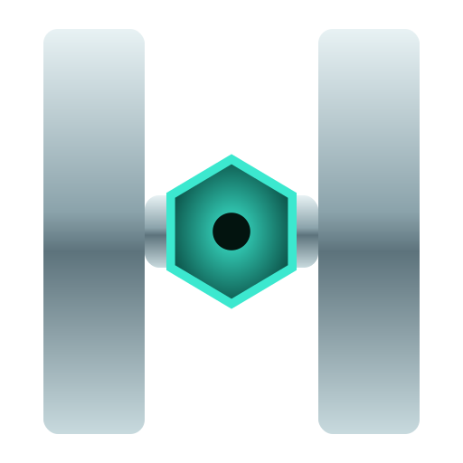

<div align="center">



# 🌌 WALI AHMAD — THE SOVEREIGN

### One Mind. Every Machine. *Order the build. Own the proof.*

[](https://wali.harmos.ai)
[](https://harmos.ai)
[](https://wali.harmos.ai)
[](https://wali.harmos.ai)
[](https://wali.harmos.ai)

</div>

---

## 🧠 Who

**Wali Ahmad** — Inventor · Founder ×3 · Cybersecurity Expert · Author.

> *"Anyone can sell you a black box. I sell mathematical proof — and I teach you to build it."*

- 🎓 **Harvard** — Master's in Cybersecurity *(candidate)* · CS50 Cybersecurity **A+**
- 🎓 **Stanford** — Quantum Mechanics & ML **A** · **Oxford Saïd** — Agentic AI **A+** · **UT Austin McCombs** — **4.33 GPA**
- 🏛️ **Forbes Technology Council** · **Marquis Who's Who**
- 📜 2 patents filed — **USPTO / PCT**
- 📚 Author — *The Thinking Millionaire* · *The 1/137 Blue Print*

---

## 🚀 The Ventures — All Live

| 🛰️ Venture | 🌍 What it is | 🔗 |
|---|---|---|
| **harmos.ai** | The Global Trust Layer for AI — every computation cryptographically proven, PQC-secured | [visit](https://harmos.ai) |
| **nooriva.ai** | Botanical glow rituals — twelve rituals on one golden amber elixir, halal-compliant | [visit](https://nooriva.ai) |
| **ourchemistry.ai** | The third venture — live now, fresh from the lab | [visit](https://ourchemistry.ai) |

---

## 🛒 The Store — 72 Offerings · 5 Lanes

| Lane | 🏷️ Name | 📦 Count | 💰 Range | ⚡ Delivery |
|---|---|---|---|---|
| **A** | Automated Products | **26** | $5 – $299 | ⚡ Instant download |
| **B** | Commissioned Builds | **23** | $2,000 – $150K+ | 🛠️ Order → Build → Deliver |
| **C** | Authority | **9** | $950/hr – six figures | 🤝 Vetted engagements |
| **D** | Academy | **9** | $500 – $60K | 🎓 Cohorts · mentorship |
| **E** | Network | **5** | Rev share · equity | 🌐 Earn with the ecosystem |

ML models · AI agents · RAG systems · websites · SaaS MVPs · blockchain · smart contracts · post-quantum cryptography · ZKML · air-gapped deployments — every delivery **cryptographically sealed**.

---

## 🎨 The Design

**The Sovereign** — deep-navy `#030c18`, teal `#3ce8cf`, gold `#f0b429`:

- ✨ Character-by-character scroll reveals
- 🌟 Rotating **capability constellation** canvas — 18 hoverable nodes wired to the offers
- 🔥 Manifesto that **ignites line by line**
- 📊 Animated 1.2M verified-node counter
- 🤖 **Ask Harmos** agent widget — floating, pulsing, always online

Alternate directions preserved: `designs.html` → 🌌 Aurora · 📐 Index · 🏠 Clubhouse.

---

## 📁 Structure

```
waliahmad/
├── index.html            # 👑 THE SOVEREIGN — final site
├── sovereign.html        # identical master copy
├── designs.html          # alternate-designs hub
├── option-a-aurora.html  # 🌌 alternate A
├── option-b-index.html   # 📐 alternate B
├── option-c-clubhouse.html # 🏠 alternate C
├── academy.html          # archive
├── terminal.html         # archive
├── assets/
│   └── logo.png          # 🖼️ LOGO — replace with the real Harmos PNG
├── CNAME                 # wali.harmos.ai (GitHub Pages)
└── .gitignore
```

---

## 🚢 Deployment

Hosted on **GitHub Pages** · DNS on **Cloudflare** · subdomain **wali.harmos.ai**.

```bash
git clone https://github.com/waliahmad-blip/waliahmad.git
```

---

<div align="center">

**📬 wali.ahmad@harmos.ai** · Lahore → Delaware → The World

*© 2026 Wali Ahmad · Harmos Inc. — Verifiable or nothing.*

</div>
